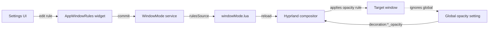

# ADR: Per-window opacity disable (ignore global opacity)

- Status: Accepted
- Date: 2026-11-14
- Supersedes: none

## Context

The shell already controls two independent visual properties of windows through
Hyprland:

- Global opacity for every window, via `decoration:active_opacity` and
  `decoration:inactive_opacity` (set in Settings > Hyprland > Decoration).
- Per-app float/stacking/tiling/span behaviour, via `services/WindowMode.qml`,
  which writes `hyprland/shellOverrides/windowMode.lua` and reconciles open
  windows. The per-app rules live in `Config.options.hyprland.windowMode.appRules`
  (`{ class, mode }`) and are edited through `modules/common/widgets/AppWindowRules.qml`.

A span rule already forces full opacity for its window, because a window
stretched over every monitor must stay fully opaque. There is currently no way
to give the same "ignore the global opacity" treatment to an ordinary window
without also stretching it. The user wants a per-window rule that disables
opacity for that window while the global opacity keeps applying to everything
else.

## Decision

Extend the existing per-app window rule with an independent boolean
`disableOpacity` (default `false`), rather than introducing a second rule list
or a new mode value.

- Config schema: `appRules` entries become `{ class, title, mode, disableOpacity }`.
  `title` is an optional regex matched against the window title, so a
  sub-window such as a browser PiP can be targeted without affecting every
  window of that app. `mode` keeps its existing semantics (stacking / tiling /
  span); opacity is orthogonal, so a window can ignore global opacity without
  changing its float behaviour.
- `WindowMode.rulesSource(currentMode, rules, spanRect)` writes
  `opaque = true` on a rule's `hl.window_rule(...)` when `disableOpacity`
  is true, in addition to whatever float/tile/size/span properties it already
  writes. A span rule keeps forcing full opacity regardless of the flag.

  The property cannot be the plainer `opacity = "1 1"` that was used when
  this ADR was first written: the compositor treats `opacity` as a
  **product** of every opacity it knows (`decoration:*_opacity` × rule ×
  …), so a rule value of `1` multiplies the global `0.85` by `1` and
  changes nothing. Measured on Hyprland 0.57.2: a window carrying
  `opacity = "1 1"` renders at exactly the same alpha as a window with no
  rule at all, while `opacity = "0.5 0.5"` renders at `0.5 × 0.85`. The
  `opaque` effect is the compositor's own "ignore the global opacity"
  switch — it pins `decoration:active/inactive/fullscreen_opacity` to 1
  for that window only (measured alpha `1.0`). The absolute spelling
  `opacity = "1 override 1 override"` also measures `1.0` and remains a
  valid alternative.
- Skip logic: a rule is omitted only when its `mode` is redundant with the
  current global mode **and** `disableOpacity` is false. A rule that only
  disables opacity is still written, as `hl.window_rule({ match = { class = ... }, opaque = true })`.
- `AppWindowRules` gains a toggle ("Disable opacity / ignore global opacity")
  inside the expanded row, persisted through the existing debounced `ListModel`
  + `commit()` path. `snapshot()` and `configSnapshot()` carry `disableOpacity`.
- Settings: the toggle lives in the existing "App window rules" subsection of
  Settings > Hyprland > Layout; no new top-level page.

The window-mode reconciliation (`reconcilePlan`) is unaffected: opacity is a
compositor rule applied at window creation and on reload, not a runtime
dispatch the shell owns.

## Diagram

## Alternatives Considered

1. Separate opacity-only rule list (`opacityRules`). Cleaner independence, but
   duplicates the class-picking, debounced edit, and commit machinery, and
   forces users to maintain two lists for the same app. Rejected for cost.
2. New mode value `"opaque"`. Overloads `mode` (float behaviour) with an
   orthogonal concern and breaks `desiredFloat` / span handling. Rejected.
3. Per-rule `opacity` string ("default"/"full") instead of a boolean. More
   extensible, but only two states are needed today and a boolean matches the
   existing toggle widgets. Deferred.

## Consequences

- Backward compatible: old configs without `disableOpacity` coerce to `false`;
  existing tests' snapshots keep passing because both sides carry the new field.
- The runtime half (`WindowMode.setOpacity`) writes the `*_override` flags
  next to the values for active, inactive and fullscreen: a value without its
  override flag is ignored by the compositor, and the inactive value is the
  one a window keeps after it loses focus. Switching the rule off clears the
  flags again, and the addresses that were forced are tracked in
  `Persistent.states.windowMode.ownedOpacity` the same way floated windows
  are tracked, so a rule that goes away hands the window back to the global
  opacity instead of leaving it opaque until it is closed.
- `rulesSource` skip test still holds for rules that are redundant in both
  dimensions.
- No new runtime dispatch or persistence beyond the existing rules file.
- Users must reload Hyprland for a change to reach already-open windows; the
  existing `hyprctl reload` on write covers this.

## Follow-up Validation

- `qml-compile-check` passes.
- `tst_app_window_rules.qml` and `tst_window_mode.qml` pass; add cases for
  `disableOpacity` in `snapshot()`/`configSnapshot()` and in `rulesSource`
  output.
- Measured on the running Hyprland 0.57.2 (red window over a green
  backdrop, alpha read from the rendered pixels):

  | rule | effective alpha |
  |---|---|
  | none (global 0.85) | 0.855 |
  | `opacity = "1 1"` (the old spelling) | 0.839 — unchanged, the bug |
  | `opacity = "0.5 0.5"` | 0.416 ≈ 0.5 × 0.85, the product rule |
  | `opaque = true` | 1.000 |
  | `opacity = "1 override 1 override"` | 1.000 |
  | runtime `set_prop` + `*_override = 1` | 1.000 |

- Manual: set global opacity < 100%, enable the toggle for one app, reload,
  confirm that app stays fully opaque while others follow global opacity.

## Implementation tasks (for /work)

1. Config: add `disableOpacity: false` default handling in `WindowMode.appRules`
   coercion (no schema change needed beyond optional field).
2. Service: update `rulesSource` skip condition and opacity emission.
3. Widget: add toggle + carry field in `snapshot`/`configSnapshot`/`loadFromConfig`.
4. Tests: extend existing tests; add opacity cases.
5. Translations: add toggle label strings.
